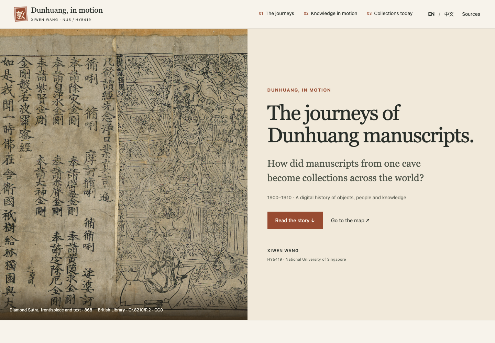
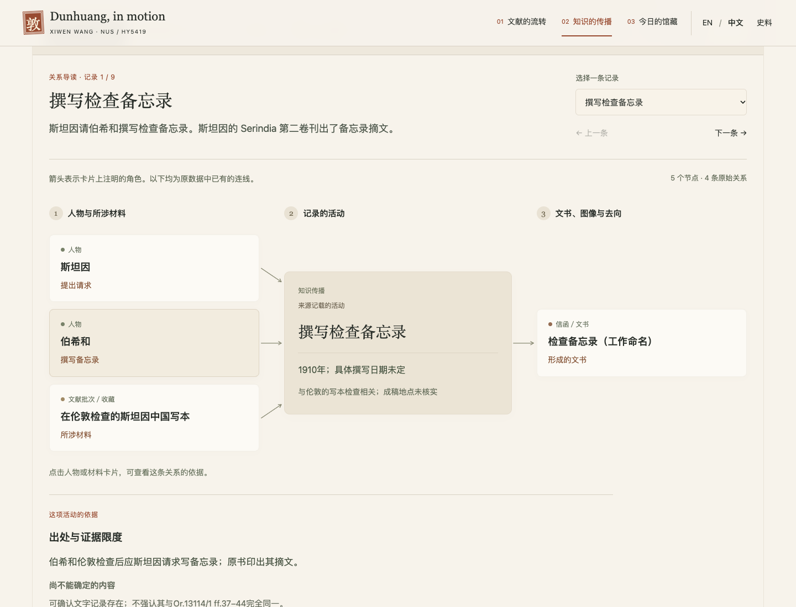
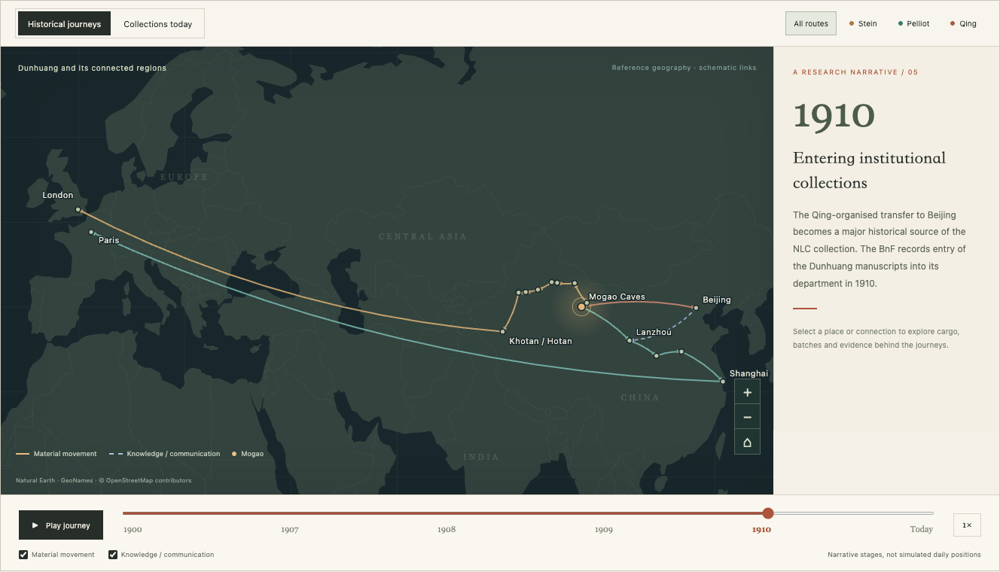
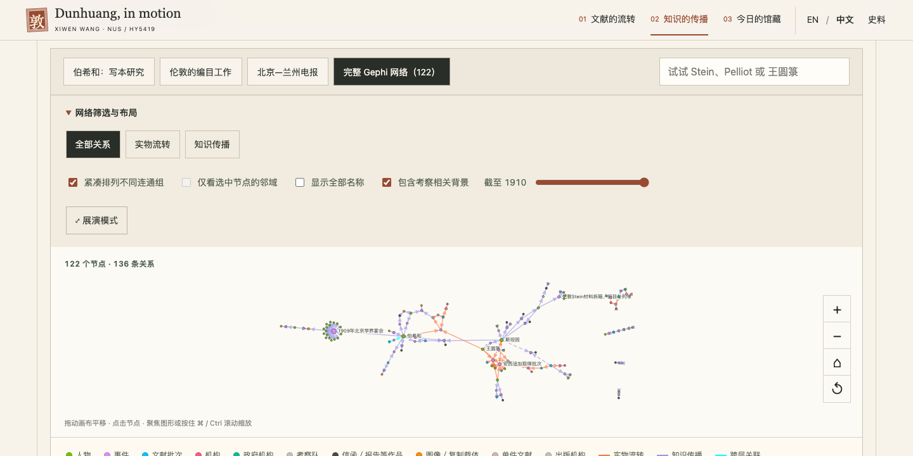

# Dunhuang / In Motion

**An English-first, bilingual digital history exhibition about Dunhuang manuscripts, their circulation, knowledge networks and collections today.**

A project by **XIWEN WANG** ([GitHub profile](https://github.com/3380903218-cmd)).

Created for **HY5419 · Digital History, National University of Singapore**, this project connects a historical route map with an interactive Gephi network. Visitors can follow the documented journeys, inspect the evidence behind individual relationships, and explore related collecting institutions.

<!-- PAGES_LINK_START -->
**Live exhibition (English):** [https://3380903218-cmd.github.io/dunhuang-in-motion/](https://3380903218-cmd.github.io/dunhuang-in-motion/)

**中文入口:** [https://3380903218-cmd.github.io/dunhuang-in-motion/?lang=zh](https://3380903218-cmd.github.io/dunhuang-in-motion/?lang=zh)

**Source repository:** [github.com/3380903218-cmd/dunhuang-in-motion](https://github.com/3380903218-cmd/dunhuang-in-motion)
<!-- PAGES_LINK_END -->



## Read the story

The exhibition follows three chapters: **the material journeys → the circulation of knowledge → collections today**. A visual cover introduces the question, a persistent chapter navigation makes the sequence visible, and larger reading text gives the historical argument space before the interactive tools.

The route map opens with one Stein-related journey. The relationship guide opens with a specific activity: Stein requests a memorandum, Pelliot writes it, and the relevant materials and document are shown alongside their recorded roles. Visitors can choose another activity, inspect its evidence, or open the **Full Gephi network (122)** with all 122 nodes and 136 relationships. Collecting institutions are grouped by London, Paris and Beijing.



This narrative layout takes inspiration from the cover, chapter navigation and text–visual pacing of [Storying on the Coquille River](https://storymaps.arcgis.com/stories/3678bc6932c74332b0d57adf3434aa55). It uses the project’s existing local assets and research records.



## Explore

- **Historical journeys:** narrative-stage playback, route filters, material and knowledge layers, and clickable evidence.
- **Interactive Gephi network:** 122 nodes, 136 directed relationships and 42 events; bilingual search, neighbourhood focus, edge inspection and year filtering.
- **Relationship guide:** full names, explicit roles and event-centred diagrams, with original source/target directions and edge-specific evidence. See [display rules and provenance](docs/RELATIONSHIP_GUIDE.md).
- **Collections today:** five related institutions across London, Paris and Beijing, with official collection links. The preservation section compares three dated treatment examples, with two further studies of fragmentation and rebinding; see [sources and boundaries](docs/PRESERVATION.md).
- **English / 中文:** switches the interface, narrative, network labels and research summaries while preserving selections.
- **Evidence access:** 21 network source entries and 49 evidence records, including English summaries and the limits of the supporting material.
- **Presentation and accessibility:** presentation mode, keyboard controls, searchable node and relationship lists, and responsive layouts.



## Research scope

The historical case study focuses on **1900–1910**. Current collecting institutions are shown separately from historical custody. The route map uses schematic geographical connections; the network uses the author's exported Gephi layout.

Cases, scrolls, objects, photographs and printed versions are distinct units. A proposed action or recorded promise is not presented as completed movement or cataloguing. Shared attendance at an event does not establish correspondence between every pair of attendees. See [Data and interpretation](DATA_NOTES.md) and the in-page source details.

The relationship guide rearranges original links around a selected event. In the full graph, compact view translates five disconnected components closer together for readability, retaining positions within each component. Visitors can restore the original Gephi layout. The downloadable GEXF retains the original exported positions, sizes and colours.

## Access check

Before the story-edition redesign, on 29 October 2026, the project owner reported a successful family test in China: the webpage, route map and relationship network all loaded. This is a user-reported test; the location, network operator and browser were not recorded. See [access-check provenance](docs/access-checks.json).

## Run locally

No package installation, API key or build is required.

```bash
python3 -m http.server 8000 --directory dist
```

Open `http://localhost:8000/`. Opening `dist/index.html` directly also works.

## Deploy with GitHub Pages

1. In the repository, open **Settings → Pages**.
2. Set **Source** to **GitHub Actions**.
3. Run the **Deploy Dunhuang exhibition to GitHub Pages** workflow, or push a change to `main`.

The workflow checks the static files and research-data counts, then publishes only `dist/`. Source code, documentation and original acknowledgements remain in the repository. The site uses relative asset paths, so it works under a GitHub project subpath.

If you fork this repository, update the canonical URL and live-demo link:

```bash
python3 tools/configure_pages.py YOUR_GITHUB_USERNAME YOUR_REPOSITORY
```

Deployment follows [GitHub's official Pages workflow documentation](https://docs.github.com/en/pages/getting-started-with-github-pages/using-custom-workflows-with-github-pages).

## Repository

```text
dist/                         Complete, buildless exhibition
  assets/                     Local image, geography and original GEXF
  data.js                     Route and collection snapshot
  network-data.js             Network, events and evidence snapshot
  app.js / network.js         Map and network interaction
  style.css / network.css     Responsive bilingual presentation
.github/workflows/pages.yml    GitHub Pages deployment
tools/                        Static checks and URL configuration
docs/                         Preview images and asset provenance
DATA_NOTES.md                 Interpretation and data boundaries
CREDITS.md                    Sources and third-party asset credits
```

This public repository contains the exhibition snapshot and its code. The research PDFs and private workspace configuration are not part of the website repository. Data updates are deliberate rather than automatic: changing a research spreadsheet does not silently change the published exhibition.

## Skills demonstrated

Historical evidence organisation · relational data modelling · Gephi network visualisation · geospatial storytelling · bilingual interface design · interactive web presentation · GitHub Pages deployment.

## 中文说明

这是一个用于NUS HY5419课程的敦煌数字历史作品，把路线地图、Gephi关系网络、今日馆藏及可追溯来源放在同一网页中。网页默认英文，支持中文切换，适合课堂展演和个人作品集展示。网址添加 `?lang=zh` 可直接以中文打开。

点击顶部 **Network／传播网络** 可搜索人物、查看关系和证据，并切换传播层或年份。点击已匹配的事件，可跳回路线地图。项目的研究范围、证据限制和资产来源分别见 [DATA_NOTES.md](DATA_NOTES.md) 与 [CREDITS.md](CREDITS.md)。

Website release **v2.2.2 · 29 October 2026**.
